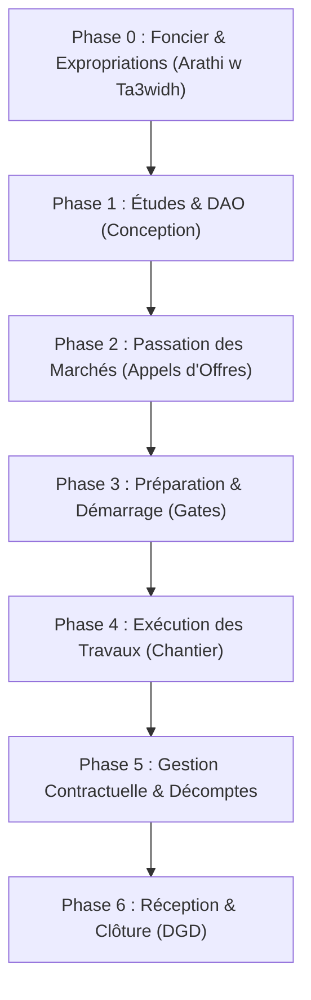

# Plan Métier Complet & Architecture GED pour Chantier de Dédoublement RN13
## Projet : Liaison Voie Express 2x2 Voies Sfax — Sidi Bouzid — Kasserine (181 km)
### Maîtrise d'Ouvrage : Ministère de l'Équipement et de l'Habitat (DGPC Tunisie)
### Bailleurs de Fonds : Banque Mondiale (BIRD) & Banque Européenne d'Investissement (BEI)

---

## 1. Contexte du Projet & Réalité Terrain en Tunisie

Le projet de dédoublement en **2x2 voies de la Route Nationale 13 (RN13)** reliant **Sfax à Kasserine** via **Sidi Bouzid** (linéaire global de ~181 km) est un mégaprojet d'infrastructure structurant pour l'économie tunisienne.

Un projet de cette envergure s'étale sur **5 à 7 ans** (phase foncière, passation, 36 à 48 mois de travaux, puis 1 an de garantie) et implique des centaines d'acteurs, des milliers de parcelles agricoles (notamment oliveraies à Sfax et Sidi Bouzid), et des dizaines de milliers de documents d'ingénierie.

### Les 5 Parties Prenantes Contractuelles
1. **Sa7eb el Machrou3 (Maître d'Ouvrage — MO)** :
   - *Entité* : Ministère de l'Équipement et de l'Habitat — Direction Générale des Ponts et Chaussées (DGPC / DGPET) & Directions Régionales (Sfax, Sidi Bouzid, Kasserine).
   - *Mission* : Direction générale du projet, passation des marchés, ordonnancement des paiements, gestion des expropriations avec le Ministère des Domaines de l'État, signature des Ordres de Service (OS) et des avenants.
2. **Entreprise de Travaux (Contractor)** :
   - *Entités types* : Groupements d'entreprises BTP (ex. Soroubat, Somatra-GET, etc.).
   - *Mission* : Réalisation physique des terrassements, chaussées, assainissement, dalots et ponts ; soumission des plans d'exécution (EXE), PAQ, métrés contradictoires, décomptes provisoires (DP), signalement des intempéries.
3. **Mission de Contrôle / Maîtrise d'Œuvre (MOE)** :
   - *Entités types* : Bureaux d'études d'ingénierie (ex. SCET-Tunisie, COMETE Engineering, Studi, etc.).
   - *Mission* : Présence permanente sur le chantier, vérification et visa formel des plans EXE (A, B, C, D), contrôle géotechnique et essais laboratoire (Proctor, CBR, béton), validation contradictoire des attachements de métrés, rédaction des PV de chantier, émission des fiches de non-conformité (NCR).
4. **Assistance à Maîtrise d'Ouvrage (AMO)** :
   - *Mission* : Conseil technique, juridique et de planification auprès du Ministère, suivi du chemin critique (planning maître), contrôle de complétude documentaire et consolidation des rapports mensuels.
5. **Bailleurs de Fonds (Donors)** :
   - *Entités* : Banque Mondiale & BEI.
   - *Mission* : Financement sous condition de conformité, délivrance des Avis de Non-Objection (ANO) obligatoires avant chaque étape clé (DAO, attribution, avenants majeurs, déblocages de prêts), supervision stricte des clauses de sauvegarde environnementale et sociale (ESS5 Réinstallation, ESS10 Consultation).

---

## 2. Découpage du Projet en Lots Géographiques

Pour assurer la faisabilité technique et la concurrence, le tracé de 181 km est divisé en **sections/lots contractuels autonomes** :
- **Lot 1 (Gouvernorat de Sfax — ~42 km)** : Sortie de Sfax ➔ Menzel Chaker (densité agricole très forte, oliveraies denses, emprises foncières complexes).
- **Lot 2 (Gouvernorats de Sfax & Sidi Bouzid — ~58 km)** : Menzel Chaker ➔ Bir Ali Ben Khelifa ➔ Ouled Haffouz ➔ Entrée de Sidi Bouzid (franchissements d'oueds, ponts mixtes, zones d'irrigation).
- **Lot 3 (Gouvernorats de Sidi Bouzid & Kasserine — ~81 km)** : Sidi Bouzid ➔ Jelma ➔ Sbeitla ➔ Kasserine (reliefs collinaires, grands terrassements, déblais rocheux, dalots hydrauliques majeurs).

---

## 3. Architecture des Documents par Phase & par Tâche

Chaque document dans l'application doit être rattaché à son **bloc de tâche** et posséder son cycle de vie propre.

### Phase 0 : Foncier, Expropriation & Indemnisations (« Arathi l'3bed w Ta3widh »)
Le bloc le plus critique qui conditionne le démarrage réel des engins :
1. **Décret d'Expropriation pour Cause d'Utilité Publique** (publié au JORT).
2. **Plans Parcellaires & Registre des Propriétaires** : levés topographiques, numéros de parcelles, superficie exacte touchée.
3. **Fiches d'Enquête Sociale & Recensement des Ménages PAP** : statut juridique (titre foncier bleu, terrain en indivision, droit coutumier), personnes vulnérables.
4. **Rapports d'Expertise Foncière & d'Évaluation des Biens** :
   - Valeur du terrain nu au mètre carré ou à l'hectare.
   - Recensement et barème des arbres fruitiers arrachés (nombre d'oliviers productifs, jeunes plants, amandiers).
   - Évaluation des bâtis détruits (maisons, clôtures, puits artésiens, bassins d'irrigation).
   - Perte de revenus commerciaux / agricoles temporaires ou permanents.
5. **Procès-Verbaux de Conciliation Amiable** (Commission Régionale d'Expertise Foncière) signés entre le propriétaire et la commission.
6. **Quittances & Ordres de Virement de Paiement** des indemnités financières intégrales.
7. **Procès-Verbal de Libération Totale d'Emprise (PVLE)** signé contradictoirement autorisant formellement l'Entreprise à pénétrer sur la parcelle.

---

### Phase 1 : Études Techniques & Dossier d'Appel d'Offres (DAO)
1. **Études Géotechniques & Tracé** : Rapports de sondages, études hydrologiques des oueds, profils en long et profils en travers types.
2. **Pièces Écrites Contractuelles du DAO** :
   - Règlement Particulier de l'Appel d'Offres (RPAO).
   - Cahier des Clauses Techniques Particulières (CCTP) terrassements, chaussées, assainissement, ouvrages d'art.
   - Cahier des Clauses Administratives Particulières (CCAP).
   - Bordereau des Prix Unitaires (BPU) et Devis Estimatif (DQE).
3. **Instruments Environnementaux & Sociaux (E&S)** :
   - Étude d'Impact Environnemental et Social (EIES).
   - Plan de Gestion Environnementale et Sociale (PGES cadre).
   - Plan d'Action de Réinstallation (PAR).
4. **Lettre d'Avis de Non-Objection (ANO) du Bailleur** sur le dossier complet avant publication.

---

### Phase 2 : Passation des Marchés & Attribution
1. **Offres des Soumissionnaires** : Dossier administratif, offre technique, offre financière.
2. **Rapport d'Évaluation des Offres Techniques (REOT)** préparé par la commission de dépouillement.
3. **Rapport d'Évaluation des Offres Financières (REOF)** et proposition d'attribution.
4. **Non-Objection Bailleur** sur la proposition d'adjudication.
5. **Contrat de Marché Notifié & Enregistré** aux impôts.
6. **Ordre de Service Général de Démarrage (OS N°01)** émis par le Ministère.

---

### Phase 3 : Préparation du Chantier & Jalons Préalables (Gates)
Aucun terrassement ne peut débuter sans validation préalable de :
1. **Plan d'Assurance Qualité (PAQ)** de l'entreprise (organigramme, procédures d'exécution, laboratoires agréés).
2. **Plan de Gestion Environnementale et Sociale Chantier (PGES-C)** : gestion des déchets, bases-vies, code de conduite contre les VBG/EAS signé par 100% des ouvriers.
3. **Plan de Gestion du Trafic (PGT)** : plans de signalisation temporaire de chantier, déviations routières approuvées par la Garde Nationale et le Ministère.
4. **Agrément des Équipes & Matériels Clés** (centrales à béton, centrales d'enrobage, finisseurs, compacteurs).

---

### Phase 4 : Exécution des Travaux (Par Tâche & Nature d'Ouvrage)

#### A. Bloc Terrassements & Plateformes
- Plans d'Exécution (EXE) des terrassements (mouvements des terres, emprunts, dépôts).
- Fiches de Demande de Réception de Fond de Fouille / Déblai.
- Essais Géotechniques de Laboratoire :
  - Compacité Proctor Normal / Modifié (seuil ≥ 95% ou 98%).
  - Indice Portant Immédiat et Portance CBR (seuil ≥ 15 à 30%).
- PV de Réception de la Couche de Forme.

#### B. Bloc Assainissement & Ouvrages Hydrauliques (Dalots & Ponts)
- Notes de calcul hydraulique et structurelle.
- Plans d'Exécution de Coffrage et Ferraillage des dalots cadres et piles de ponts.
- Agréments des Centrales à Béton et carrières d'agrégats.
- Fiches de Coulage de Béton avec prélèvement d'éprouvettes cylindriques.
- Résultats d'Écrasement d'Éprouvettes Béton à 7 jours et 28 jours (résistance fc28 ≥ 25 ou 30 MPa).
- PV de Réception des Armatures avant coulage (contradictoire MOE / Entreprise).

#### C. Bloc Chaussées & Revêtements Bitumineux
- Fiches d'Agrément de la Carrière et essais Los Angeles / Micro-Deval sur les granulats.
- Formulation et agrément des graves non traitées (GNT 0/31.5) pour la couche de fondation.
- Formulation du Béton Bitumineux / Grave Bitume (GB et BBME 0/14) pour couche de liaison et de roulement.
- Bilans de compactage continu et essais de carottage de chaussée (épaisseur et pourcentage de vide).
- Essais d'adhérence et d'uni longitudinal (APL).

#### D. Bloc Équipements de Sécurité & Signalisation
- Plans de signalisation horizontale (peinture thermoplastique rétro-réfléchissante).
- Plans de signalisation verticale (panneaux de police et de direction).
- Fiches d'agrément des glissières de sécurité métalliques / béton (BN4).

---

### Phase 5 : Suivi Contractuel, Financier, Retards & Incidents

#### Chaîne Causale : Comment les événements sont liés entre eux ?
1. **Événement déclencheur (Fait générateur)** :
   - Exemples : Intempéries exceptionnelles (pluies torrentielles bloquant le chantier), découverte de réseau concessionnaire non répertorié (SONEDE, STEG, Tunisie Télécom), retard de libération d'une parcelle foncière contestée.
2. **Constat contradictoire** :
   - Fiche d'intempérie ou PV de constat dressé avec la MOE le jour même.
3. **Ordre de Service (OS)** :
   - OS d'Arrêt Partiel ou Total des travaux sur la section concernée émis par le Maître d'Ouvrage.
4. **Impact sur le planning** :
   - Mesure du retard sur le chemin critique du planning prévisionnel (MS Project / Primavera).
5. **Instruction par la MOE & l'AMO** :
   - Analyse de la réclamation d'entreprise (Claim) : vérification de l'imputabilité.
6. **Ordre de Service de Reprise (OS)** :
   - Dès levée de la contrainte.
7. **Avenant Contractuel au Marché** :
   - Avenant de délai (prorogation de la durée contractuelle de X jours).
   - Avenant financier (si surcoût imprévu validé).
   - Soumission obligatoire pour **Avis de Non-Objection au Bailleur**.

#### Décomptes Mensuels (IPC / Décomptes Provisoires)
- **Attachements de métrés contradictoires** signés sur le terrain entre le métreur de l'Entreprise et le technicien de la MOE.
- **Décompte Mensuel Provisoire (DP N° X)** : calcul des quantités exécutées x prix unitaires du bordereau.
- **Déductions réglementaires** : retenue de garantie (10%), remboursement d'avance forfaitaire.
- **Certificat de Paiement émis par la MOE** dans un délai de 15 jours.
- **Ordonnancement et Mandatement par le Maître d'Ouvrage** sous 30 jours.
- **Virement effectif et quittance de règlement**.

---

### Phase 6 : Clôture, Réceptions & Période de Garantie
1. **Procès-Verbal de Réception Provisoire (PVRP)** avec liste des réserves mineures à lever sous 30 à 60 jours.
2. **Dossier des Ouvrages Exécutés (DOE / As-Built)** : plans définitifs de récolement et fiches techniques remises à la direction de l'exploitation.
3. **Décompte Général et Définitif (DGD)** : solde de tous les comptes, réclamations et pénalités éventuelles.
4. **Période de Garantie de Parfait Achèvement (12 mois)**.
5. **Procès-Verbal de Réception Définitive (PVRD)** et libération de la caution bancaire de retenue de garantie.

---

## 4. Les Tableaux de Bord Dédiés par Rôle

Chaque acteur doit avoir une vue ultra-claire axée sur ses responsabilités quotidiennes :

### 1. Tableau de Bord Maître d'Ouvrage (Ministère de l'Équipement — DGPC)
- **KPIs stratégiques** : Taux d'avancement physique cumulé vs Planning contractuel, montant total ordonnancé, consommation du prêt Bailleur.
- **Actions immédiates** :
  - Décomptes mensuels certifiés par la MOE en attente d'ordonnancement de paiement.
  - Demandes d'Avis de Non-Objection à transmettre au Bailleur.
  - Ordres de Service (OS) d'arrêt/reprise ou d'avenant à signer.
  - Alertes foncières : tronçons où les terrassements approchent d'une parcelle non encore libérée.

### 2. Tableau de Bord Entreprise de Travaux (Soroubat / BTP)
- **KPIs d'exécution** : Cadence journalière de terrassement (m³/jour), linéaires de couche de base posés (km), état de facturation des métrés.
- **Actions immédiates** :
  - Déposer les plans d'exécution (EXE) des ouvrages à venir sous 15 jours.
  - Déclarations d'intempéries ou de contraintes d'emprise à soumettre.
  - Fiches de non-conformité (NCR) ouvertes à corriger avec proposition d'action curative.
  - Préparer les attachements du décompte mensuel du mois écoulé.

### 3. Tableau de Bord Mission de Contrôle / Maîtrise d'Œuvre (SCET-Tunisie)
- **KPIs de contrôle** : Nombre de plans en attente de visa (respect du délai contractuel de 15 jours), essais de laboratoire non conformes, fiches NCR actives.
- **Actions immédiates** :
  - Poste de visa des plans d'exécution (A, B, C, D) avec formulaire de réserves.
  - Réception de ferraillage avant coulage de dalots.
  - Validation contradictoire des attachements de métrés de l'entreprise.
  - Vérification des fiches d'agrément de matériaux de carrières.

### 4. Tableau de Bord Bailleur de Fonds (Banque Mondiale / BEI)
- **KPIs de conformité de prêt** : Taux de décaissement de l'accord de prêt, respect des jalons critiques, indicateurs d'accidents graves HSE.
- **Actions immédiates** :
  - Demandes d'Avis de Non-Objection (ANO) sur dossiers d'appel d'offres, attributions ou avenants.
  - Rapports trimestriels de surveillance environnementale et sociale (E&S).
  - Suivi des notifications d'incidents graves sous 48h.
  - Suivi du taux d'indemnisation effective des populations affectées (PAR).

---

## 5. Spécification Détaillée du Module « Arathi l'3bed w Ta3widh » (Foncier & PAR)

Ce module est conçu pour être géré de manière limpide par les ingénieurs et juristes fonciers :

### Structure d'une Fiche Parcelle / Propriétaire :
- **Identifiant parcelle** : Code normalisé `RN13-PARC-L01-PK04-012`.
- **Localisation** : Gouvernorat (Sfax / Sidi Bouzid / Kasserine), Délégation, Imada, PK début et PK fin.
- **Propriétaire / Exploitant (PAP)** :
  - Nom, prénom, N° CIN (Carte d'Identité Nationale), Téléphone.
  - Nature du droit : Propriétaire avec Titre Foncier (Livre Foncier), Enquête de possession (Houlk), Héritier en indivision, ou Occupant agricole sans titre.
- **Consistance de l'emprise expropriée** :
  - Superficie totale de la parcelle / Superficie empiétée par le projet (m² ou Hectares).
  - Végétation & Arbres : Nombre d'oliviers adultes productifs, oliviers jeunes, figuiers, amandiers.
  - Constructions & Améliorations : Murs de clôture, maison d'habitation, puits de surface, bassin de collecte d'eau (Majel), sondage agricole.
- **Calcul Financier du Dédommagement (Barème Officiel)** :
  - Indemnité foncière terrain : `Surface (m²) x Prix unitaire (DT/m²)`.
  - Indemnité des arbres fruitiers : `Nombre d'oliviers x Barème unitaire Ministère Agriculture (DT/pied)`.
  - Indemnité du bâti et équipements hydrauliques : Évaluation d'expert de remplacement.
  - Indemnité de vulnérabilité / réinstallation temporaire.
  - **Montant Total Indemnisé (en Dinars Tunisiens — DT)**.
- **Chaîne Documentaire de la Parcelle (Fichiers Uploadés)** :
  1. *Fiche d'identification et copie CIN*.
  2. *Plan de bornage topographique parcellaire*.
  3. *Procès-verbal d'expertise foncière contradictoire*.
  4. *PV de conciliation amiable signé devant la Commission Régionale*.
  5. *Quittance de paiement de la Trésorerie Générale / Reçu de virement bancaire*.
  6. *Procès-Verbal de Libération Totale d'Emprise (PVLE)* signé avec remise des clés/accès.
- **Statut Visuel Clair de la Parcelle** :
  - `Recensé` ➔ `Offre Transmise` ➔ `Accord Signé` ➔ `Payé Intégralement` ➔ `Emprise Libérée (Autorisé pour Travaux)`.
- **Règle Métier Inviolable** : Tant que la parcelle n'est pas à l'état `Emprise Libérée`, la section de travaux correspondante (Jalon / Gate) reste au statut **BLOQUÉ** pour l'Entreprise.

---

## 6. Synthèse des Écrans à Enrichir dans la GED-RN13 V2

1. **Dashboard Spécifique par Rôle** :
   - Accueil MO (DGPC), Accueil Entreprise, Accueil MOE, Accueil Bailleur, Accueil AMO.
2. **Nouveau Module Foncier & Indemnisations (« Arathi w Ta3widh »)** :
   - Tableau interactif de toutes les parcelles par PK et Gouvernorat.
   - Fiche détaillée du propriétaire avec calcul des oliviers/terrains/bâtis en TND.
   - Upload des quittances et signature du PV de libération d'emprise.
3. **Module Suivi de Chantier par Tâche & Chaîne Causale (Avis, Retards, Intempéries, OS, Avenants)** :
   - Fiches d'intempéries et d'arrêts.
   - Générateur et registre des Ordres de Service (OS).
   - Dossier d'avenant lié au motif de retard et demande d'ANO Bailleur.
4. **Gestionnaire d'Upload & Dossier Documentaire par Phase** :
   - Visualisation arborescente claire par phase (Foncier, DAO, PAQ, Terrassement, Chaussée, Ouvrages d'art, Décomptes).
   - Zone de glisser-déposer de vrais fichiers (PDF, plans DWG/PDF, tableurs XLSX d'attachements) avec aperçu immédiat et calcul SHA-256.
